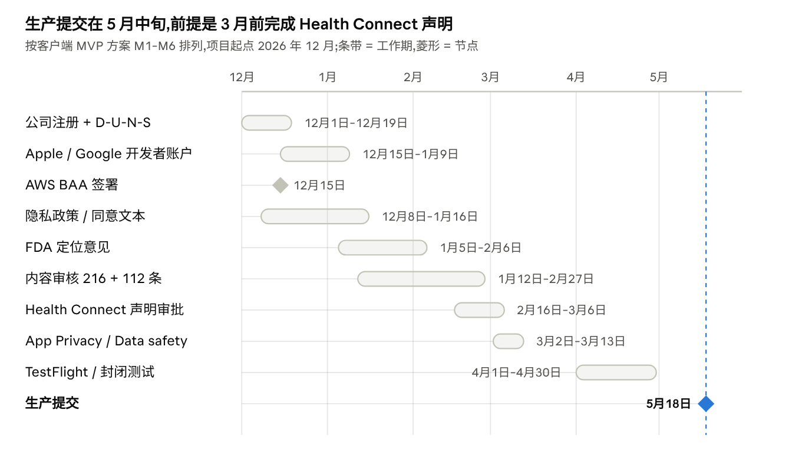

# 中医AI健康管家 · 上架合规清单

2026-11-24 · 在线可编辑版本:https://claude.ai/artifact/7b4XyVsZxk8oL4F7uAPm3f(以在线版为准,本文件为导出快照)

把「中医AI健康管家」上架 Apple App Store 和 Google Play,公司需要满足三层要求:两个商店对任何发行方的账户与主体要求、商店对健康类 App 的专项审核规则、以及商店不检查但健康 App 公司必须自己做到的法规与内容要求。本清单按这三层展开,配合《客户端 MVP 开发方案》M1 的法务任务使用;每项的负责人和完成日期待公司指定。

商店费用微不足道(Apple $99/年 + Google $25 一次),真正的成本在法务(隐私政策、州法审查、FDA 意见,方案预算 $25k–40k)和中医顾问的内容审核。商店对应用内订阅抽成 15%(年收入首 $100 万内),诊所付费的 B2B2C 模式不经过商店,不产生抽成。

## 一、公司主体与开发者账户

两个商店都要求以**组织**(而非个人)身份注册,前提是一家已注册的公司和一个 D-U-N-S 编号;商店页面会公开显示公司的法定名称与地址。

| # | 事项 | Apple | Google | 负责人 | 完成日期 | 状态 |
| --- | --- | --- | --- | --- | --- | --- |
| 1 | 公司注册(LLC / Inc.),取得 EIN | 必需 | 必需 |  |  |  |
| 2 | D-U-N-S 编号(Dun & Bradstreet 免费申请,约 1–2 周) | 组织注册必需 | 组织注册必需(2023 起) |  |  |  |
| 3 | 开发者账户 | Apple Developer Program,$99/年;由有法律签署权的人注册;Apple 核验主体 1–7 天 | Google Play Console,$25 一次;提交公司注册文件、地址、电话、邮箱核验 |  |  |  |
| 4 | 公开显示的开发者信息 | 法定名称、地址、联系方式 | 同左;还需一个公开的开发者邮箱 |  |  |  |
| 5 | 收款与税务 | 银行账户 + W-9 | Google Payments 账户 + 税表 |  |  |  |
| 6 | 构建与提交工具 | Xcode(需 Mac)或 Expo EAS 云端构建 | Android Studio 或 EAS |  |  |  |
| 7 | 应用名称与 Bundle ID / 包名预留 | App Store Connect 中创建 App 记录 | Play Console 中创建应用 |  |  |  |

组织账户还有一个实际好处:Google 要求新的个人账户先做 14 天、至少 20 人的封闭测试才能上生产,组织账户豁免。

## 二、法律与隐私文件

隐私政策、商店的数据声明和代码的实际行为必须三者一致——两家商店都会比对,不一致是最常见的被拒原因。所有文件中英双语。

| # | 文件 / 事项 | 为什么需要 | 依据 | 负责人 | 完成日期 | 状态 |
| --- | --- | --- | --- | --- | --- | --- |
| 1 | 隐私政策(网页链接 + App 内可访问) | 两商店必填;必须列出收集的每类数据、用途、保留期、第三方 | Apple 5.1.1 / Google User Data policy |  |  |  |
| 2 | 使用条款(含“非医疗建议”条款) | 责任边界;商店要求健康类 App 有明确免责 | Apple 1.4.1 |  |  |  |
| 3 | 健康数据专项同意文本(独立于隐私政策,带版本号) | 加州 CPRA 与华盛顿州 MHMDA 要求对消费者健康数据单独明示同意;MHMDA 有私人诉讼权 | CPRA §1798.121;WA RCW 19.373 |  |  |  |
| 4 | 消费者健康数据隐私政策(WA MHMDA 要求单独页面链接) | 法定格式,需从主页可达 | WA RCW 19.373.010 |  |  |  |
| 5 | COPPA 合规说明(家庭档案含未成年人) | 监护人创建、数据不进分析与评估集 | 16 CFR 312 |  |  |  |
| 6 | FDA 定位意见书(律师) | 确认 MVP 功能落在 General Wellness 指南内,不构成医疗器械软件;V3 慢病功能前评估 CDS 豁免 | FDA General Wellness Guidance(2019);CDS Guidance(2022) |  |  |  |
| 7 | 法务审查全部用户可见文案 | “改善睡眠质量”可,“治疗失眠”不可;涉及中药只能作膟食补充剂描述 | FDA / FTC / DSHEA |  |  |  |
| 8 | 数据处理清单(内部) | 填写 Apple App Privacy 和 Google Data safety 的依据;与《数据架构与存储策略》第 2 节一致 | — |  |  |  |
| 9 | AWS BAA | MVP 阶段即签,V2 对接诊所成为 Business Associate 时不用迁移 | HIPAA |  |  |  |
| 10 | LLM 供应商 BAA | 对话已含症状描述;建议 M3 联调前完成 | HIPAA |  |  |  |
| 11 | 数据泄露响应预案 | FTC Health Breach Notification Rule 适用于非 HIPAA 的健康 App;州法 72 小时内确定影响范围 | 16 CFR 318 |  |  |  |

第 3–4 项容易被忽略:即使 App 不叫“医疗”,体质答题里的排便、带下、情绪、过敏在这两部州法下都属于敏感健康数据。

## 三、Apple App Store 专项

Apple 对健康类 App 的审核集中在三条指南:5.1.3(健康数据用途)、1.4.1(身体伤害与医疗准确性)、5.1.1(隐私与账户删除);我们的“不诊断、不开方、分流到医生”设计正是审核员要看的。

| # | 要求 | 指南条款 | 我们的对应 | 负责人 | 完成日期 | 状态 |
| --- | --- | --- | --- | --- | --- | --- |
| 1 | HealthKit 数据不得用于广告、数据挖掘、出售;不得存入 iCloud;请求权限必须有可见的用户价值 | 5.1.3 | 只读睡眠、步数两类;原始样本不落盘不上传;预填打卡 |  |  |  |
| 2 | `NSHealthShareUsageDescription` 文案说逅用途 | 5.1.1(i) | “用于预填你的睡眠和步数打卡,不上传原始记录” |  |  |  |
| 3 | 医疗类内容需来自可信来源并有免责声明;不得暂示诊断 | 1.4.1 | 知识层每条带来源;方案页固定免责;分流卡 / 紧急卡 |  |  |  |
| 4 | App Privacy “营养标签”:逐类申报收集的数据、是否关联身份、是否用于追踪 | 5.1.1 | 按《数据架构》第 2 节填写:健康与健身、联系信息、标识符、使用数据;不追踪 |  |  |  |
| 5 | App 内账户删除 | 5.1.1(v) | 设置页“删除账户”,72 小时内完成 |  |  |  |
| 6 | 第三方登录若提供 Google 登录则必须同时提供 Sign in with Apple | 4.8 | 登录选项:手机号 OTP、Apple、Google |  |  |  |
| 7 | 年龄分级问卷 | — | “Medical/Treatment Information: Infrequent/Mild”→ 12+ |  |  |  |
| 8 | 加密出口合规 | — | 仅标准 HTTPS,选“豁免”;Info.plist 设 `ITSAppUsesNonExemptEncryption=false` |  |  |  |
| 9 | 应用内购买规则:数字订阅必须走 IAP(抽成 15% / 30%) | 3.1.1 | MVP 无付费;若未来诊所付费属 B2B,不经 IAP |  |  |  |
| 10 | 实体商品(药膳、额粒)可用第三方支付,但不得宣称疗效 | 3.1.5 / 1.4.1 | MVP 不接商品 |  |  |  |
| 11 | 审核备注(Review Notes) | — | 提供测试账号、说明体质量表来源与不构成诊断的理由、指出免责与分流位置 |  |  |  |
| 12 | TestFlight(最多 10,000 测试者) | — | M5 诊所 Beta 用 TestFlight,无需公开上架 |  |  |  |

审核时长通常 24–48 小时;健康类可能被追问内容来源,备注写全可省一轮往返。

## 四、Google Play 专项

Google 的门槛在两份声明表:Health apps 声明和 Health Connect 权限声明,后者需单独审批(1–2 周),会阻塞发布,要最早提交。

| # | 要求 | 政策 | 我们的对应 | 负责人 | 完成日期 | 状态 |
| --- | --- | --- | --- | --- | --- | --- |
| 1 | Health apps 声明:在 Play Console 说明健康功能用途,选入健康类别;医疗声明需证据 | Health apps policy | 定位“Wellness”;不作诊断或治疗声明 |  |  |  |
| 2 | Health Connect 权限声明表:逐类说明读取理由;禁止广告、出售、超范围共享 | Health Connect policy | 只申请 Sleep、Steps 读权限;用途 = 预填打卡 |  |  |  |
| 3 | Data safety 分节:逐类申报收集、共享、加密、可删除 | User Data policy | 与隐私政策、App Privacy 标签三者一致 |  |  |  |
| 4 | 账户删除:App 内 + 商店页的网页链接 | User Data policy(2024) | 设置页 + 网站删除页面 |  |  |  |
| 5 | 隐私政策 URL(商店页 + App 内) | — | 同第二节第 1 项 |  |  |  |
| 6 | 目标 API 级别:需在最新 Android 发布后一年内 | Target API requirements | Expo SDK 跟进;每年 8 月前升级 |  |  |  |
| 7 | 权限最小化;敏感权限需说明 | Permissions policy | 仅通知 + Health Connect;不要位置、联系人、相机 |  |  |  |
| 8 | 医疗与健康内容不得误导;补充剂不得宣称疗效 | Inappropriate content / Health | 同第六节措辞规则 |  |  |  |
| 9 | 应用内购买:数字订阅走 Google Play Billing(15% / 30%) | Payments policy | MVP 无付费 |  |  |  |
| 10 | 内容分级问卷(IARC) | — | 预计 Everyone / Teen |  |  |  |
| 11 | 测试轨道:内部测试(100 人)→ 封闭测试 → 开放测试 → 生产 | — | M5 诊所 Beta 用封闭测试;组织账户豁免 14 天 / 20 人要求 |  |  |  |
| 12 | Android 13 及以下 Health Connect 需用户单独安装 | — | 检测不到时隐藏预填功能,回到手动输入 |  |  |  |

审核通常数天;Health Connect 声明单独走流程,建议 M3 联调一完成就提交。

## 五、产品内必备功能

这些是两家商店都会在 App 里实际点开检查的功能;demo 里已有原型,正式版需要真实实现。

- [ ] 首次使用三项逐条确认:隐私政策、健康数据用途、非医疗建议;同意记录带版本号和时间(`consents` 表)
- [ ] 方案页、食疗页、穴位页底部固定免责声明;文案经法务审查
- [ ] 医疗问题分流卡 + 紧急关键词全屏卡(911 / 988),紧急词典在本地,不依赖网络
- [ ] 账户删除:App 内入口 + 网页入口;72 小时内级联删除,含家庭成员数据
- [ ] 数据导出(JSON,24 小时有效链接)
- [ ] 权限最小化:只请求通知与健康数据读权限;健康权限在打卡页首次需要时请求,不在首次启动时
- [ ] 健康数据只派生不留存:原始样本内存处理后丢弃,仅写派生值(睡眠小时数、步数)
- [ ] 未成年成员:监护人创建、带标识;数据不进分析仓和评估集(数据库策略层强制)
- [ ] 家庭成年成员须本人确认授权,可随时撤销
- [ ] 登录方式含 Sign in with Apple(因为提供了 Google 登录)
- [ ] 所有联网请求 HTTPS;令牌存 Keychain / Keystore;本地健康数据 SQLCipher 加密
- [ ] 隐私政策与条款在 App 内可达(设置页),不只是商店链接
- [ ] 老年模式与系统动态字体支持;VoiceOver / TalkBack 走查(非商店硬性要求,但是驳回投诉的常见来源)

其中前五项是审核员最常实际操作的;缺任何一项都会被直接驳回。

## 六、内容与医学边界

商店、FDA 和州法都看同一件事:App 说的是“养生”还是“诊疗”。措辞规则要写进内容审核流程,而不是上架前临时改。

| 可以说 | 不能说 |
| --- | --- |
| 改善睡眠质量、帮助放松 | 治疗失眠、缓解焦虑症 |
| 适合气虚体质、按体质调养 | 调理高血压、辅助降血糖 |
| 传统上用于、性味归经 | 疗效、疗程、剂量、克 / 钱 |
| 体质偏向、初步判断 | 诊断、确诊、病、症候、证型(面向用户时) |
| 建议咨询医生、帮你记录症状 | 可以停药、代替治疗 |

- [ ] 禁用词表进入内容审核和问答出口校验(正则 + 模型双重)
- [ ] 216 条节气 × 体质提示经中医顾问审核(已有 Excel 审核表)
- [ ] 112 条方案内容条目经审核,`source.reviewed` 置 true,补 `reviewed_by / reviewed_at`(已有 Excel 审核表)
- [ ] 60 题量表文字逐条核对 ZYYXH/T 157-2009 原文
- [ ] 每条内容带可点开的来源(书目 + 章节),审核员追问“可信来源”时可直接展示
- [ ] 名医特色内容(136 位名老中医)进入知识层前取得授权;MVP 只用国标、公版经典和自有内容
- [ ] 商店截图与描述不出现疾病名、疗效词;应用分类选“Health & Fitness”而非“Medical”
- [ ] 英文文案由英语母语中医师审校,体质名用描述式译名

“症候、证型”在医生端可以用,在患者端的面向用户文案里不用,只说“体质”。

## 七、商业与品牌

这三项不影响审核通过,但上架后再改代价很高。

| # | 事项 | 说明 | 负责人 | 完成日期 | 状态 |
| --- | --- | --- | --- | --- | --- |
| 1 | 商标检索与申请 | “中医AI健康管家”及英文名在 USPTO 检索;商店对重名和侵权投诉会下架;App 名称在 App Store Connect 中需唯一 |  |  |  |
| 2 | 收费模式定案 | 诊所付费(B2B2C)不经商店、无抽成;若未来做用户订阅,必须走 IAP / Play Billing,抽成 15%(年收入 ≤ $100 万)或 30% |  |  |  |
| 3 | 保险 | 产品责任险 / E\&O;健康相关消费产品的投资人和诊所合作方通常会要求 |  |  |  |
| 4 | 开发者名称 | 商店显示的是法定实体名;若希望显示品牌名需先注册同名实体或 DBA |  |  |  |
| 5 | 支持渠道 | 商店要求公开支持邮箱 / 网址;健康类 App 的用户投诉响应时效影响评分与下架风险 |  |  |  |

## 八、时间线

两个阻塞项决定节奏:D-U-N-S 不下来开不了开发者账户,Health Connect 声明不批发不了 Android 生产版。诊所 Beta 走 TestFlight 和封闭测试,不依赖公开上架,所以 4 月的 Beta 不被 5 月的生产提交卡住。日期按项目 2026 年 12 月启动估算,公司确定起点后整体平移。
